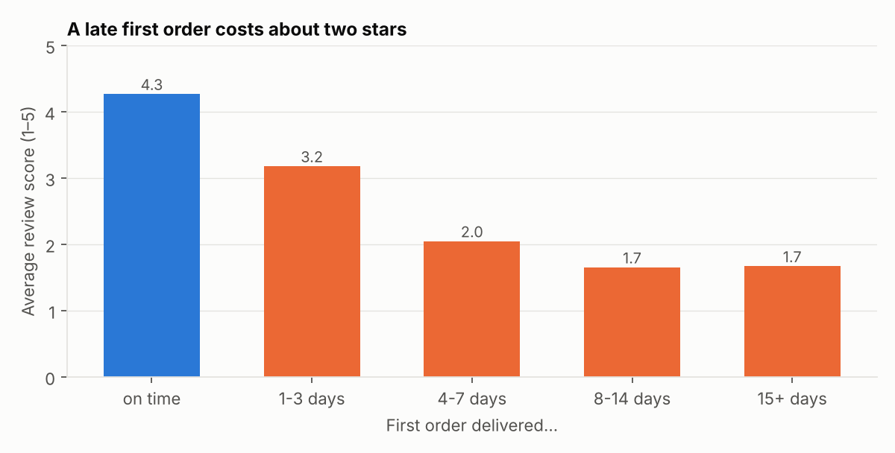
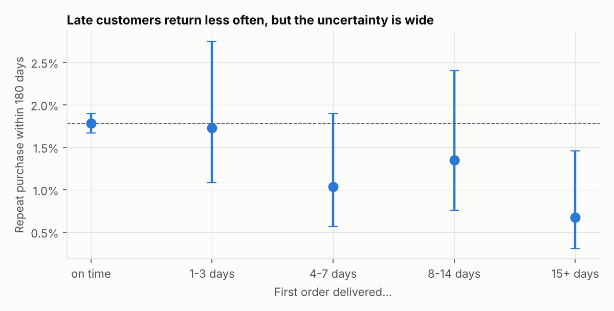
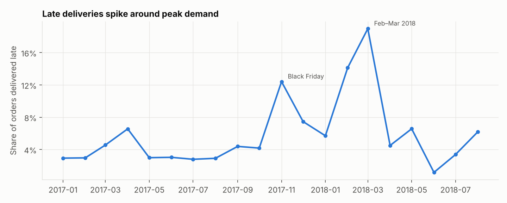
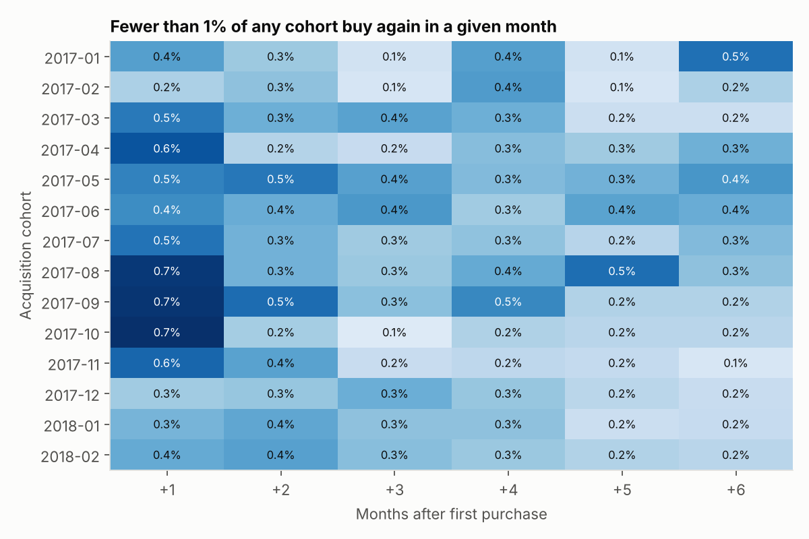

# Does a Late Delivery Cost a Repeat Customer?

**An e-commerce analytics case study on 96k customers of the Olist marketplace (Brazil, 2017–2018).**

When a customer's first order arrives late, does that customer come back less often? And is that where
the real cost lies?

**Answer:** A late first order lowers the odds of a repeat purchase by about **28%**. Its effect on
satisfaction is much larger and much more certain: **−2.0 stars** on the review. Because only 1.7% of
customers return at all, lateness cost about **21 repeat customers** in this cohort, against **2,339
one- and two-star reviews**. In this marketplace, late delivery is mainly a *reputation* problem, not a
*retention* problem. That changes where the money should go.



**Stack:** Python (pandas, statsmodels) · Jupyter · logistic regression with robust SEs · cohort analysis

**→ [Read the full analysis notebook](notebooks/analysis.ipynb)**

---

## Findings

| | Result | Certainty |
|---|---|---|
| First orders delivered late | 6.6% (3% in a normal month, 12% at Black Friday, 19% in Mar 2018) | High |
| Effect on review score (with controls) | **−2.04 stars** (95% CI −2.09 to −1.98) | High |
| Reviewed late orders rated 1–2 stars | 65%, vs 10% of on-time orders | High |
| Effect on repeat purchase within 180 days | odds ratio **0.72** (95% CI 0.53–0.98, p = 0.04), or −0.56 pp on a 1.74% base | Moderate |
| …after also controlling for the review score | odds ratio 0.82, not significant | Suggests the effect runs through dissatisfaction |
| Repeat customers lost to lateness in the cohort | about 21 (95% CI 1–40) | Low |



## Recommendation

1. **Pad promise dates in peak weeks.** The late rate jumps 4–6× around Black Friday and in Feb–Mar.
   A more conservative estimated delivery date costs nothing and prevents most of the damage.
2. **Contact customers before they write the review.** Send a proactive delay message or a small voucher
   for orders that are about to miss their date. Run it as an **A/B test**, with the review score as
   the primary metric and repeat purchase as a secondary one.
3. **Don't build the business case on retention.** With a 1.7% base repeat rate, even eliminating
   lateness would bring back only a few dozen customers. The case rests on ratings and seller reputation.



## Method

- **Unit:** each customer's *first* order, placed Jan 2017 to Feb 2018 and delivered, which leaves at
  least 180 days of follow-up (55,196 customers).
- **Exposure:** delivered after the estimated date shown at checkout, also split into 1–3, 4–7, 8–14 and
  15+ days late.
- **Outcome:** a new order placed *after the first one arrived* and within 180 days. 831 customers whose
  second order came before the first was delivered (split baskets) do not count as repeats.
- **Identity trap:** Olist issues a new `customer_id` for every order. Repeat behaviour exists only at the
  level of `customer_unique_id`, and analyses that skip this step find 0% retention.
- **Model:** logistic regression controlling for customer state, product category, basket value, freight
  share, item count and purchase month, with heteroskedasticity-robust standard errors. A second model
  adds the review score to test whether the effect runs through dissatisfaction.
- **Limitations:** the data is observational, so an unmeasured factor (for example, poor sellers who are
  both slow and low quality) could drive both lateness and churn. The repeat sample is small (961
  returners), and the data covers only 2017–18.



## Reproduce

```bash
pip install -r requirements.txt
python src/download_data.py          # fetches the public data from Olist's GitHub repo
python src/build_dataset.py          # builds data/processed/first_orders.csv
jupyter nbconvert --to notebook --execute --inplace notebooks/analysis.ipynb
```

```
src/download_data.py   fetch raw CSVs (not committed; CC BY-NC-SA 4.0)
src/build_dataset.py   one row per customer: first order, lateness, review, repeat flag, controls
src/make_notebook.py   generates the notebook from plain text (diff-friendly)
notebooks/analysis.ipynb   the analysis, with outputs
```

**Data:** [Olist public dataset](https://github.com/olist/work-at-olist-data), CC BY-NC-SA 4.0.

---

*Author: Ahmet Uygun, MS in Computer Science & Information Systems (UNCW). See also:
[Retail analytics from a hand-kept cash ledger](https://github.com/uygunmutfakekipmanlari/uygun-retail-analytics).*
